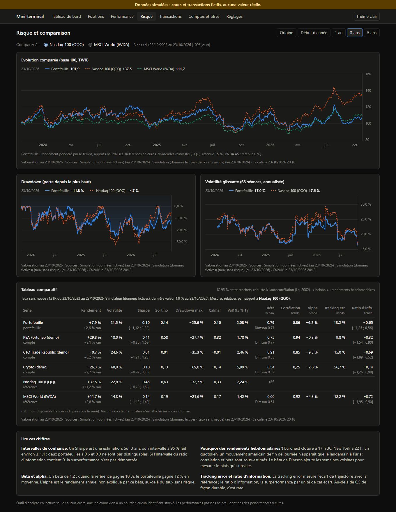
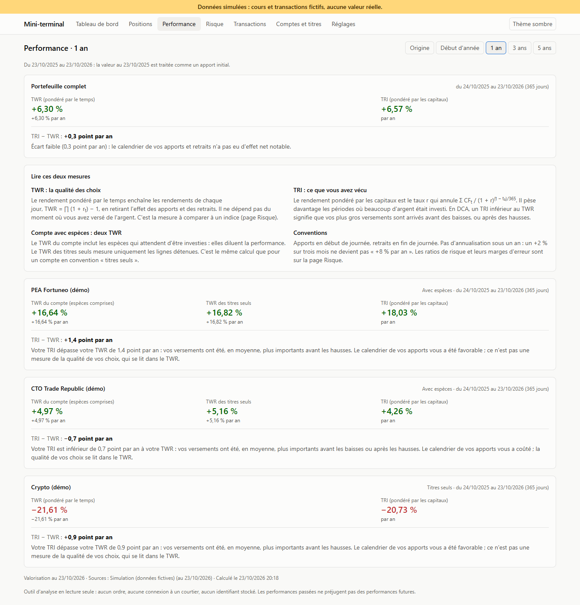
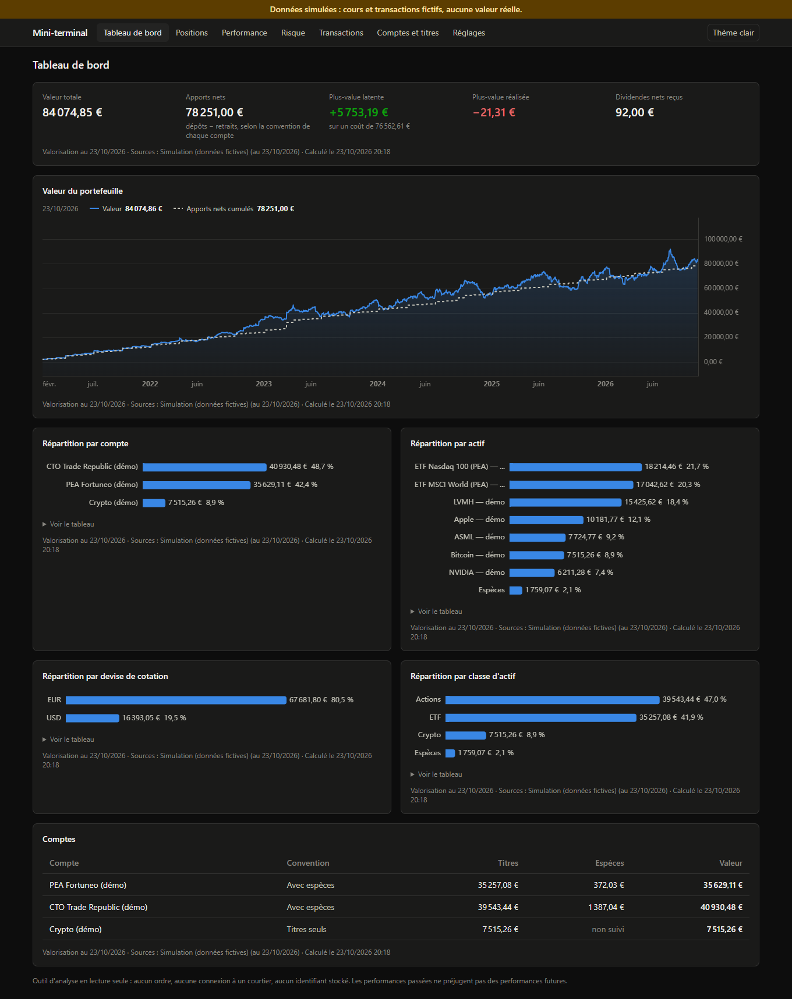
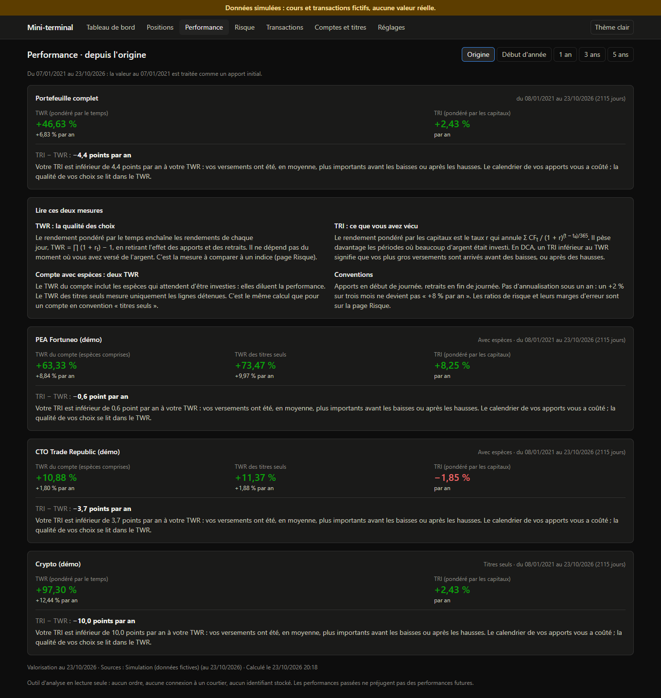
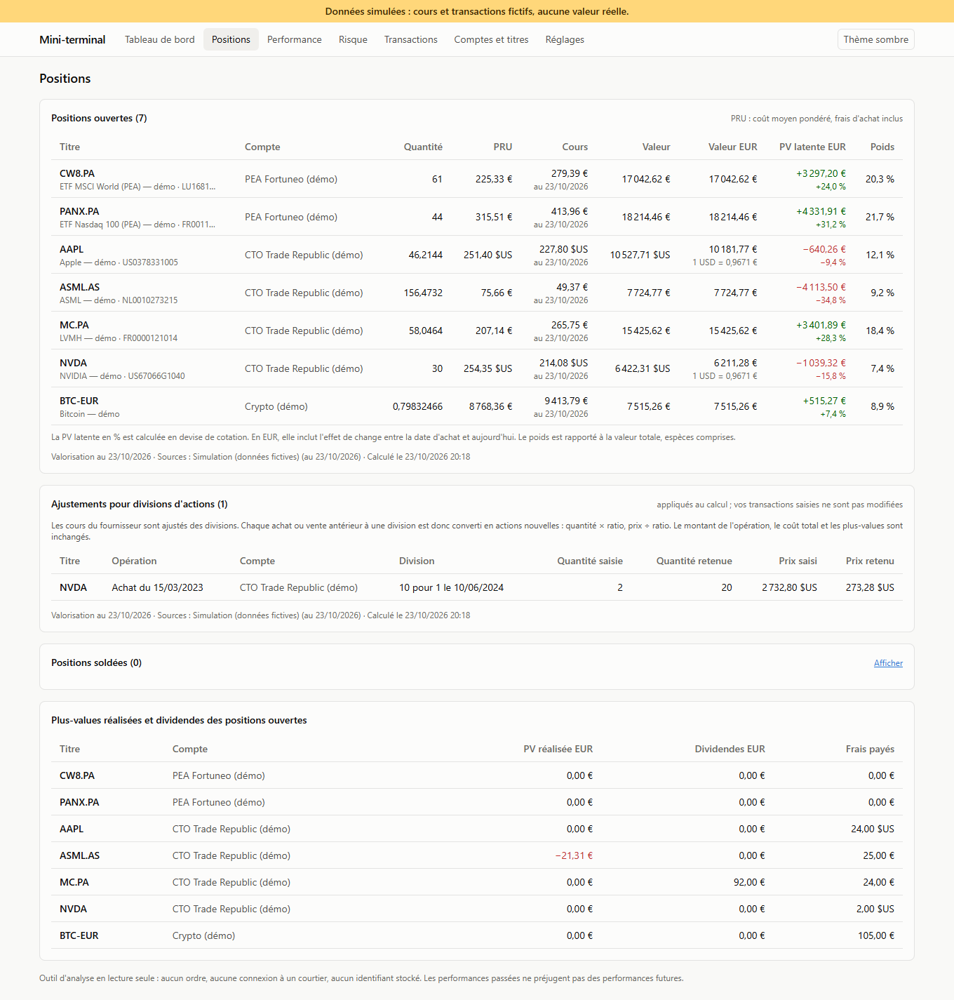
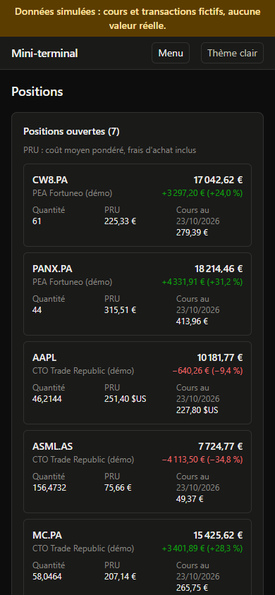

# Mini-terminal

Application web d'analyse de portefeuille personnel, construite à partir des **transactions réelles** :
positions, prix de revient, plus-values, performance mesurée de deux façons (TWR et TRI), et comparaison au
Nasdaq 100 et au MSCI World en euros, avec la marge d'erreur de chaque ratio.
Devise de référence : l'euro. Plusieurs comptes (compte-titres, PEA, crypto), actifs cotés en EUR ou en USD.

L'application **lit et analyse, elle n'agit pas** : aucune exécution d'ordre, aucune connexion à un courtier,
aucun identifiant stocké.

| Risque et comparaison | Performance par période (thème clair) |
|---|---|
|  |  |
| **Tableau de bord (thème sombre)** | **Performance depuis l'origine** |
|  |  |
| **Positions (thème clair)** | **Positions sur mobile** |
|  |  |

*Captures en mode démo : cours et transactions simulés, signalés par le bandeau en haut de page. Les cours simulés
suivent des profils de long terme (Nasdaq 100 : 14 % d'espérance, 22 % de volatilité ; MSCI World : 9 % et 15 % ;
bitcoin : 30 % et 65 %). La graine retenue est la première dont la trajectoire 2021-2026 reste dans des ordres de
grandeur historiques, selon des critères écrits et testés (`terminal/marketdata/simulated.py`). Ce n'est pas une
trajectoire choisie pour flatter le portefeuille.*

## État du projet

| Phase | Contenu | État |
|---|---|---|
| 1 | Comptes, transactions, import CSV, positions, PRU, plus-values, TWR, TRI, tableau de bord | **terminée** |
| 2 | Indicateurs de risque sur le TWR réel, comparaison au Nasdaq 100 et au MSCI World en EUR, intervalles de confiance, périodes | **terminée** |
| 3 | Corrélations, contributions au risque, ENB (ACP et torsion minimale), simulateur | à venir |
| 4 | Fiche par action, DCF inversé | à venir |

## Installation

Prérequis : Python 3.12+, Node.js 20.19+ (testé avec 26.9). Docker est facultatif.

### Développement, sans Docker

```powershell
python -m venv .venv
.venv\Scripts\python -m pip install -r requirements-dev.txt
cd frontend; npm install; cd ..

.\scripts\dev.ps1            # données réelles (Yahoo Finance)
.\scripts\dev.ps1 -Demo      # données simulées, base séparée pré-remplie
```

Le script ouvre deux fenêtres : l'API sur http://127.0.0.1:8000 (documentation interactive sur `/docs`) et
l'interface sur **http://localhost:5173**. À la main, sous macOS ou Linux :

```bash
.venv/bin/python -m uvicorn backend.app.main:create_app --factory --reload   # MT_DEMO=1 pour la démo
cd frontend && npm run dev
```

### Avec Docker

```bash
docker compose up --build              # http://localhost:8080
MT_DEMO=1 docker compose up --build    # mode démo
```

La base SQLite est conservée dans le volume `mt-data`.

### Tests

```powershell
.venv\Scripts\python -m pytest --cov      # 193 tests ; couverture du module de calcul : 98 %
cd frontend; npx tsc -p .                # vérification des types
```

### Réglages (variables d'environnement, préfixe `MT_`, ou fichier `.env`)

| Variable | Défaut | Rôle |
|---|---|---|
| `MT_DEMO` | `0` | `1` : fournisseur simulé et base `data/demo.db` pré-remplie |
| `MT_PROVIDER` | `yahoo` | `yahoo` ou `simule` |
| `MT_DB_PATH` | `data/mini_terminal.db` | fichier SQLite |
| `MT_CACHE_TTL_MINUTES` | `360` | durée de validité du cache des cours du jour |

## Premiers pas

1. **Comptes et titres** : créez vos comptes. Pour chacun, choisissez une convention de flux :
   - *avec espèces* : vous saisissez dépôts et retraits, et le solde d'espèces fait partie du compte ;
   - *titres seuls* : chaque achat est un apport, chaque vente un retrait (pratique pour la crypto).
2. Ajoutez vos cotations par leur ticker Yahoo (`PANX.PA`, `CW8.PA`, `AAPL`, `BTC-EUR`). La devise est lue chez
   le fournisseur. L'ISIN est facultatif ; il regroupe plusieurs cotations d'un même titre.
3. **Transactions** : saisie manuelle, ou import CSV avec aperçu avant écriture. Format :
   [`docs/FORMAT_CSV.md`](docs/FORMAT_CSV.md), exemple : [`examples/transactions_exemple.csv`](examples/transactions_exemple.csv).
4. **Réglages** : références de comparaison (QQQ et IWDA.AS par défaut), retenue à la source sur leurs dividendes,
   taux sans risque (€STR, taux fixe ou nul), fenêtre de la volatilité glissante.
5. **Performance** et **Risque** : choisissez la période (origine, début d'année, 1, 3 ou 5 ans). La période suit
   d'une page à l'autre.

## Architecture

```
mini_terminal/
├── terminal/                 Cœur de calcul : aucune dépendance web, base ou réseau (sauf yahoo.py)
│   ├── ledger.py             Comptes, transactions (Decimal), validation, règle unique des flux externes
│   ├── positions.py          Quantités, PRU (PMP), PV latente et réalisée, espèces, en devise et en EUR
│   ├── valuation.py          Valorisation quotidienne par compte, flux externes, poche titres
│   ├── performance.py        TWR, TRI (Brent), annualisation
│   ├── metrics.py            Indicateurs (Sharpe, Sortino, bêta…), IC de Lo, bêta de Dimson
│   ├── risk.py               Périodes, jours ouvrés et semaines, tableau comparatif et ses règles
│   ├── benchmark.py          Références dividendes réinvestis, converties en euros
│   ├── riskfree.py           Taux sans risque : raccord EONIA / €STR, convention ACT/360
│   ├── splits.py             Ajustement des transactions pour les divisions d'actions
│   ├── marketdata/
│   │   ├── base.py           Interface MarketDataProvider et erreurs typées
│   │   ├── yahoo.py          Implémentation yfinance (seul fichier qui l'importe)
│   │   ├── simulated.py      Implémentation simulée (tests, démo)
│   │   ├── rates.py          Interface des taux au jour le jour, version simulée
│   │   └── ecb.py            €STR et EONIA de la BCE (seul fichier qui appelle la BCE)
│   └── data.py, engine.py, charts.py, views.py   utilisés par legacy/
├── backend/app/              FastAPI + SQLAlchemy 2 + SQLite
│   ├── models.py, db.py      Tables ; type DecimalText (Decimal exact dans SQLite)
│   ├── market.py             Cache en base des cours, dividendes, divisions et taux
│   ├── settings_store.py     Réglages d'analyse, stockés en base
│   ├── services/             portfolio.py (base -> cœur -> réponses), csv_import.py, ledger_check.py
│   └── routers/              accounts, listings, transactions, portfolio, analysis (risque, réglages)
├── frontend/                 React + TypeScript + Vite + Tailwind ; Lightweight Charts, ECharts
├── tests/, backend/tests/    Tests du cœur et de l'API
├── docs/                     Format CSV, captures
├── examples/                 Fichier CSV d'exemple
├── legacy/                   Ancienne application Streamlit et rapport HTML (non maintenus)
└── METHODE.md                Formules, conventions, limites, sources
```

Principes :

- **Le calcul ne connaît ni le web ni la base.** `terminal/` reçoit des transactions et des séries de cours,
  et renvoie des résultats. Le backend ne fait que charger, appeler et mettre en forme.
- **Changer de fournisseur de données** se fait dans un seul fichier : une nouvelle classe qui implémente
  `MarketDataProvider`, enregistrée dans `terminal/marketdata/__init__.py`. Le cache en base fonctionne avec
  n'importe laquelle.
- **Montants exacts.** `Decimal` dans la base (stocké en texte : `Numeric` serait un flottant dans SQLite), dans
  le grand livre et dans l'API (chaînes JSON). Les flottants ne servent qu'aux séries statistiques.
- **Rien n'est inventé.** Une donnée manquante vaut `null` et s'affiche « manquant » ; un total incomplet n'est
  pas affiché. Les données simulées déclenchent un bandeau sur toutes les pages. Chaque bloc indique sa date
  de valorisation et ses sources.
- **Validation complète à chaque écriture.** Ajout, modification, suppression et import revalident tout
  l'historique : vente à découvert, dépôt sur un compte « titres seuls », devise incohérente sont refusés.

Méthode de calcul détaillée : [`METHODE.md`](METHODE.md).

## Limites connues

- **Écarts avec les courtiers.** La valeur affichée peut différer de celle de vos courtiers, pour plusieurs raisons :
  - le taux de change (taux de marché Yahoo, et non celui du courtier) ;
  - la place de cotation (Yahoo prend la clôture d'Euronext ou du Nasdaq, Trade Republic valorise sur LS Exchange) ;
  - l'heure (en séance, Yahoo renvoie un cours intrajournalier, mis en cache 6 h) ;
  - pour la crypto, la source du prix.
- **Yahoo Finance** est gratuit et non garanti : erreurs ponctuelles, données parfois absentes. Une panne
  n'efface rien : le dernier cache est servi, et sa date est indiquée.
- **Pas d'import direct des relevés Trade Republic ou Fortuneo** : il faut passer par le format CSV documenté.
- **Pas de virements entre comptes** : un transfert se saisit comme un retrait sur un compte et un dépôt sur
  l'autre. Chaque compte reste juste. Pour le portefeuille total, le transfert compte en revanche comme un retrait
  et un apport le même jour, au lieu de ne rien changer. Les apports nets restent justes et l'effet sur le TWR est
  très faible (le rendement de ce jour-là est légèrement amorti).
- **Divisions d'actions** : gérées automatiquement à partir de l'historique Yahoo (voir METHODE.md). Saisissez
  les quantités et prix **d'origine**, tels qu'ils figuraient sur l'avis d'opération. Si un courtier a réécrit
  votre historique en quantités déjà ajustées, saisies telles quelles, elles seraient ajustées une seconde fois :
  vérifiez la liste des ajustements (page Positions).
- **Autres opérations sur titres non gérées** : fusion, scission, attribution gratuite, staking. Frais prélevés en
  crypto non gérés : les saisir en EUR.
- **Fiscalité non calculée** : pas d'impôt latent, pas de règles PEA (plafond, retraits). Les dividendes sont
  saisis nets.
- **Devise de référence fixe** : EUR uniquement.
- **Cours du jour en séance** : avant la clôture, Yahoo renvoie le dernier prix échangé. Les valeurs du jour bougent
  donc d'un calcul à l'autre (mis en cache 6 h). Pour une mesure stable, regardez la veille.
- **Références** : QQQ n'est pas accessible à un particulier français (fonds américain non UCITS) ; c'est un
  indicateur de marché. La retenue de 15 % sur ses dividendes est une hypothèse réglable. Écarts détaillés dans
  METHODE.md.
- **Intervalles de confiance** : formule de Lo (2002) pour des rendements indépendants. Avec de l'autocorrélation,
  l'intervalle réel est plus large que celui affiché.
- **Biais résiduel** : même en hebdomadaire, Euronext et New York ferment à 4 h 30 d'écart. Comparez le bêta et
  le bêta de Dimson : un écart signale ce biais.
- **Taux sans risque** : marche de 8,5 points de base au raccord EONIA / €STR du 01/10/2019 (voir METHODE.md).
  Si la BCE est injoignable et sans cache, le calcul se fait avec un taux nul et le signale.
- **Bases d'annualisation** : rendement annualisé en jours calendaires (365), volatilité et ratios en séances (252)
  ou en semaines (52), selon la convention de chaque mesure.
- **Petits écarts d'arrondi** entre la courbe de valeur (flottants) et les totaux (`Decimal`) : au plus
  quelques centimes.
- **Pas de migrations de schéma** (Alembic) : les tables sont créées au démarrage. Un changement de schéma
  dans une phase suivante demandera une migration ou une recréation de la base.
- **Interface sans authentification** : prévue pour un usage local. Ne l'exposez pas sur Internet telle quelle.

## Ancienne version

L'application Streamlit d'origine (portefeuille théorique à poids constants) reste dans `legacy/` :

```powershell
.venv\Scripts\python -m pip install -r legacy\requirements.txt
.venv\Scripts\streamlit run legacy\app.py
.venv\Scripts\python legacy\report.py --demo     # rapport HTML autonome
```
